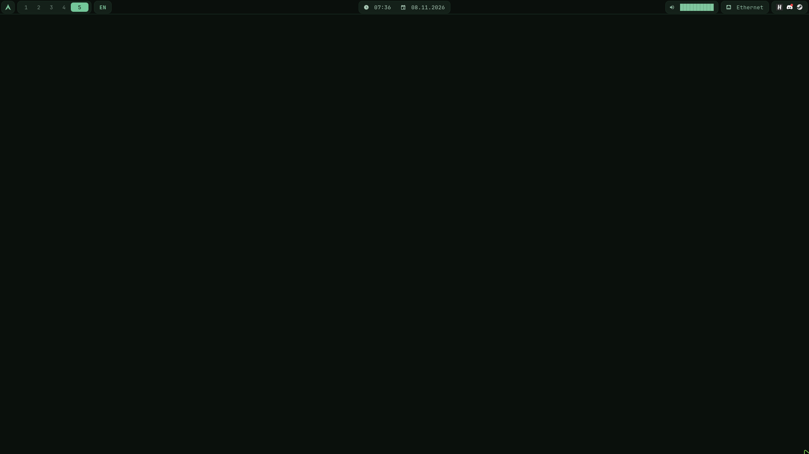
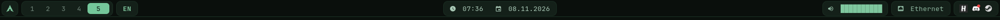
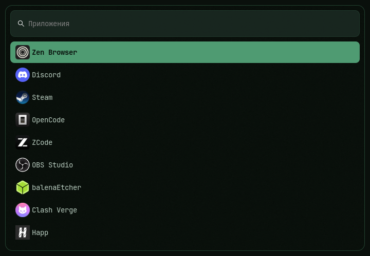
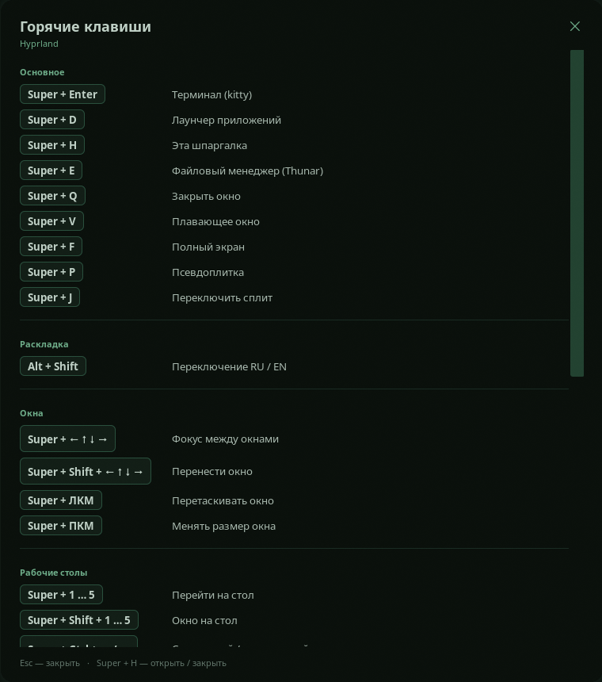

# Hyprland Dotfiles — LordWerdes

Тёмно-зелёное окружение для **Arch Linux** и производных: Hyprland с Lua-конфигом, компактный Waybar, Wofi с прозрачностью и размытием, аккуратная GTK-шпаргалка по биндам.

Обои по умолчанию **отключены** — Hyprland рисует тёмный фон сам. Так задумано, и это выглядит чище.



## Скриншоты

**Waybar**



**Wofi**



**Шпаргалка по биндам**



## Что внутри

- **Hyprland 0.57+ (Lua)** — плавные анимации, blur, округлые углы, VRR в полноэкранных приложениях, автоопределение монитора.
- **Waybar** — компактный бар: анимированная полоска громкости, подсветка активного стола, часы с русской датой, Ethernet/Wi-Fi, трей.
- **Wofi** — лаунчер на layer-shell: прозрачный фон, blur, аккуратная сетка. `Super + D` открывает и закрывает его.
- **Bindhelp** — шпаргалка по горячим клавишам на GTK3: секции, клавиши-кнопки, прокрутка, закрытие по `Esc`. `Super + H`.
- **Kitty** — тёмно-зелёная тема терминала, прозрачность 88%, padding и Hack Nerd Font.
- **Скриншоты** — `Print` (область в буфер) и `Super + Print` (весь экран в `~/Pictures`).
- **install.sh / uninstall.sh** — установка с бэкапом и полным откатом.

## Поддержка железа

При установке `install.sh` сам определяет GPU и создаёт `~/.config/hypr/local.lua`:

| GPU | Что настраивается |
|---|---|
| **NVIDIA** | `LIBVA_DRIVER_NAME=nvidia`, `__GLX_VENDOR_LIBRARY_NAME=nvidia`, `NVD_BACKEND=direct`, `GBM_BACKEND=nvidia-drm`, отключение аппаратного курсора |
| **AMD** | `LIBVA_DRIVER_NAME=radeonsi` |
| **Intel** | `LIBVA_DRIVER_NAME=iHD` |
| **Гибрид** | определяется автоматически: рабочий стол на iGPU, NVIDIA — через PRIME |
| **Гибрид с MUX** | если в BIOS включён только NVIDIA — `./install.sh --gpu nvidia` |

Для гибридных ноутбуков (например, Intel + RTX 3050 Mobile) скрипт видит **оба** адаптера и пишет безопасный профиль: композитор работает на встроенной графике, а дискретная NVIDIA используется для игр и рендера:

```bash
__NV_PRIME_RENDER_OFFLOAD=1 __GLX_VENDOR_LIBRARY_NAME=nvidia <команда>
```

Если ноутбук переключён в режим только дискретной графики (MUX), запусти установку с `--gpu nvidia`.

Курсор: `install.sh` находит установленную тему (`Bibata-Mint`, `Bibata-Modern-Ice`, `Adwaita` и т.д.), прописывает её в `local.lua` и отключает синхронизацию с gsettings — из-за неё курсор мог полностью исчезать.

Монитор определяется автоматически: максимальное разрешение и герцовка (`highrr`), масштаб — `auto`. Если нужен конкретный режим, поправь `hl.monitor` в `hyprland.lua`.

## Совместимость с дистрибутивами

- **Arch Linux** и любые Arch-based дистрибутивы.
- Пакеты ставятся через `pacman`, поддерживаются `sudo` и `doas`.
- Проверка зависимостей идёт через `pacman -T`, поэтому `-git`-версии и `provides` не приводят к установке дублей.
- Если какого-то пакета нет в репозитории, `install.sh` предупредит и продолжит установку.
- Конфиг рассчитан на **Hyprland 0.57+** (Lua-конфиг). На более старых версиях будет предупреждение.

## Требования

Arch Linux (или производный дистрибутив) и пакеты:

```bash
hyprland waybar wofi kitty grim slurp wl-clipboard python python-gobject gtk3 \
ttf-hack ttf-jetbrains-mono-nerd hyprpaper pipewire wireplumber libpulse \
networkmanager pavucontrol thunar brightnessctl playerctl \
hyprcursor adwaita-cursors xdg-desktop-portal-hyprland
```

`install.sh` сам проверит зависимости и предложит доустановить недостающие через `pacman`. `hyprpaper` нужен только если захочешь включить обои.

## Установка

```bash
# перейди в папку, куда скачал или клонировал проект
cd /путь/к/hyprland-dotfiles
chmod +x install.sh uninstall.sh
./install.sh
```

Скрипт:

1. определяет дистрибутив и GPU;
2. проверяет и при необходимости ставит пакеты;
3. делает бэкап текущих `hypr`, `waybar`, `wofi`, `kitty` в `~/.config/dotfiles-backup-ДАТА`;
4. копирует конфиги;
5. генерирует `~/.config/hypr/local.lua` под твой GPU;
6. выставляет права на скрипты;
7. перезагружает Hyprland, перезапускает Waybar и демон громкости;
8. проверяет `hyprctl configerrors`.

Флаги:

| Флаг | Что делает |
|---|---|
| `-y`, `--yes` | не задавать вопросов |
| `--no-deps` | не проверять и не ставить пакеты |
| `--no-reload` | не перезагружать Hyprland/Waybar |
| `--keep-local` | не перезаписывать свой `~/.config/hypr/local.lua` |
| `--gpu <тип>` | принудительный профиль: `auto`, `nvidia`, `amd`, `intel`, `hybrid` |
| `-h`, `--help` | справка |

## Удаление

```bash
cd /путь/к/hyprland-dotfiles
./uninstall.sh
```

Скрипт остановит Waybar, демон громкости, wofi, шпаргалку и hyprpaper, затем восстановит **самый ранний** бэкап из `~/.config/dotfiles-backup-*` — то есть состояние до первой установки. Если конфига до установки не было — удалит поставленный (по метке `.dotfiles-lordwerdes`). Если бэкапа нет — предложит удалить конфиги.

Флаги: `-y`, `--yes`, `--no-reload`, `-h`, `--help`.

## Обои (опционально)

По умолчанию обои выключены. Чтобы включить:

1. открой `config/hypr/hyprpaper.conf` и раскомментируй `preload` / `wallpaper`;
2. замени `HDMI-A-1` на имя своего монитора (`hyprctl monitors`);
3. добавь в `hyprland.lua` в блок `hl.on("hyprland.start", ...)` строку:

```lua
hl.exec_cmd("hyprpaper")
```

4. перезапусти Hyprland или выполни `hyprpaper`.

## Горячие клавиши

`Mod = Super (Win)`

### Основное
| Бинд | Действие |
|---|---|
| `Super+Enter` | Терминал (kitty) |
| `Super+D` | Лаунчер приложений (wofi, toggle) |
| `Super+H` | Шпаргалка по биндам (toggle) |
| `Super+E` | Файловый менеджер (Thunar) |
| `Super+Q` | Закрыть окно |
| `Super+V` | Плавающее окно |
| `Super+F` | Полный экран |
| `Super+P` | Псевдоплитка |
| `Super+J` | Переключить сплит |

### Окна и столы
| Бинд | Действие |
|---|---|
| `Super+стрелки` | Фокус между окнами |
| `Super+Shift+стрелки` | Перенести окно |
| `Super+ЛКМ` / `Super+ПКМ` | Перетаскивание / ресайз |
| `Super+1..5` | Перейти на стол |
| `Super+Shift+1..5` | Окно на стол |
| `Super+Ctrl+стрелки` | Соседний стол |
| `Super+колесо` | Листать столы |

### Scratchpad
| Бинд | Действие |
|---|---|
| `Super+S` | Показать/спрятать стол «magic» |
| `Super+Shift+S` | Закинуть окно туда |

### Звук, яркость и медиа
| Бинд | Действие |
|---|---|
| `Super+Alt+↑/↓` | Громкость |
| `Super+Alt+Space` | Мьют |
| `XF86 Volume` | Громкость/мьют |
| `XF86 Mic` | Выключить микрофон |
| `XF86 Brightness` | Яркость экрана |
| `XF86 Play/Next/Prev` | Управление плеером |

### Система и скриншоты
| Бинд | Действие |
|---|---|
| `Super+L` | Погасить экран |
| `Super+Shift+R` | Перезагрузить конфиг |
| `Super+Shift+C` | Выход из Hyprland |
| `Print` | Скриншот области в буфер |
| `Super+Print` | Скриншот экрана в `~/Pictures` |

## Структура

```
hyprland-dotfiles/
├── config/
│   ├── hypr/
│   │   ├── hyprland.lua       # основной конфиг
│   │   ├── local.lua          # генерируется под GPU
│   │   ├── wofi.sh            # лаунчер + шпаргалка
│   │   ├── bindhelp.py        # GTK-шпаргалка
│   │   ├── hyprpaper.conf     # обои (по умолчанию выключены)
│   │   ├── wall.jpg
│   │   └── BINDINGS.md
│   ├── waybar/
│   │   ├── config.jsonc
│   │   ├── style.css
│   │   └── scripts/
│   │       ├── volume.py      # демон плавной громкости
│   │       └── volume-print.sh
│   ├── wofi/
│   │   ├── config
│   │   └── style.css
│   └── kitty/
│       └── kitty.conf         # тема терминала
├── assets/                    # скриншоты
├── install.sh                 # установка с бэкапом
├── uninstall.sh               # откат к бэкапу
├── LICENSE
└── README.md
```

## Настройка под себя

- Монитор и разрешение — `config/hypr/hyprland.lua` (`hl.monitor`).
- Анимации и blur — там же, `decoration` и `hl.animation`.
- Настройки GPU и курсора — `~/.config/hypr/local.lua` (или `config/hypr/local.lua` в репозитории).
- Цвета Waybar и Wofi — в соответствующих `style.css`.
- Громкость: демон `volume.py`, состояние в `~/.cache/waybar/volume.json`.
- Список биндов — `config/hypr/bindings.txt` и `BINDINGS.md`.

## Если что-то не так

- **Конфиг не загрузился** — выполни `hyprctl configerrors`, затем `./uninstall.sh` для отката.
- **Пропал курсор** — поставь `sudo pacman -S adwaita-cursors hyprcursor`, затем `./install.sh --yes --no-deps --no-reload` (он заново подберёт тему) или вручную `hyprctl setcursor Adwaita 24`. В конфиге уже отключена синхронизация с gsettings.
- **Waybar не появился** — запусти `waybar` вручную из терминала и посмотри вывод.
- **Нет звука/полоски громкости** — проверь `wpctl status`; нужны `pipewire` и `wireplumber` (или PulseAudio + `libpulse`).
- **Wofi без прозрачности и blur** — убедись, что Hyprland 0.57+ и в конфиге есть `hl.layer_rule` для namespace `wofi`.
- **Другой монитор** — поправь `hl.monitor` в `config/hypr/hyprland.lua` под своё разрешение и частоту.
- **NVIDIA-приложение не запускается** — проверь `local.lua` и драйвер; для PRIME используй `__NV_PRIME_RENDER_OFFLOAD=1`.
- **Гибридный ноутбук** — `install.sh` сам определит Intel/AMD + NVIDIA и настроит PRIME. Если в BIOS включён MUX, запусти `./install.sh --gpu nvidia`.

## Соцсети

- YouTube: [@LordWerdes](https://www.youtube.com/@LordWerdes)
- Telegram: [lordwerdes1337](https://t.me/lordwerdes1337)
- Discord: `lordwerdes`, `lordwerdes1337`

## Лицензия

MIT — делай что хочешь, только не продавай как своё.
